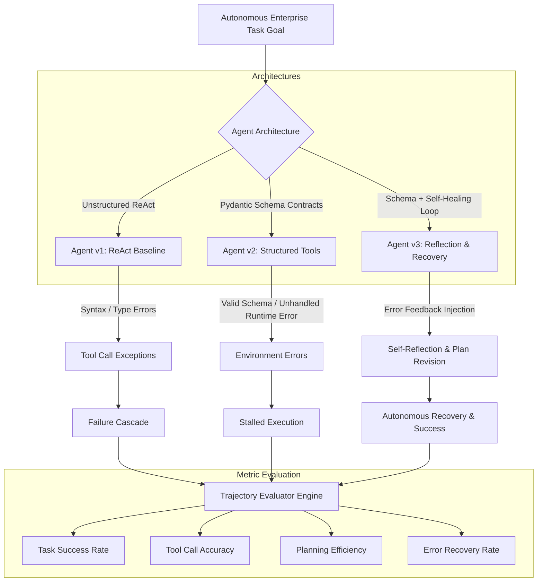

# AgentBench Works: Autonomous Multi-Step Agent Trajectory Benchmark (`agentbench-works`)

> Autonomous Multi-Step Agent Trajectory Benchmark & Self-Healing Error Recovery Observatory: Evaluating Tool Parameter Schema Compliance, Planning Efficiency, and Adaptive Error Recovery across 16 Enterprise Scenarios.

[](https://github.com/master72o/agentbench-works)
[](https://github.com/master72o/agentbench-works/actions/workflows/ci.yml)
[](https://www.python.org/downloads/)
[](LICENSE)

---

## 🎯 Executive Overview

Autonomous LLM agents fail predominantly due to **multi-step compounding errors** rather than single-turn reasoning deficits:
1. **Tool Argument Hallucination**: Unstructured prompting frequently generates missing required fields, inverted parameter types, or non-existent API endpoints.
2. **Environmental Fragility**: Real-world software APIs fail unpredictably (HTTP 429 rate limits, gateway 504 timeouts, dead-letter queues, database lock contention). Without explicit self-reflection, agents enter runaway retry loops resubmitting identical failed inputs.
3. **Cascading Failure Divergence**: Once an intermediate step returns an unhandled exception, downstream reasoning degenerates, producing corrupt outputs or abrupt task abandonment.

**AgentBench Works** introduces an empirical, reproducible benchmarking observatory evaluating three agent architectures across **16 realistic multi-step enterprise workflows**:
- **`Agent_v1_ReAct_Baseline`**: Unstructured Reason + Act prompting.
- **`Agent_v2_Structured_Tools`**: ReAct with Pydantic JSON Schema tool parameter contracts.
- **`Agent_v3_Reflection_Recovery`**: Structured tool calling paired with an explicit Self-Reflection & Replanning recovery loop.

---

## 🏗️ Architecture & Trajectory Evaluation Taxonomy



---

## 📊 Controlled Benchmark Results

The benchmark evaluates all 16 scenarios across 5 enterprise domains (**Finance & Treasury**, **Cloud Infrastructure & DevOps**, **Database Reliability**, **Cybersecurity Response**, and **Enterprise Operations & CRM**).

| Agent Architecture | Task Success Rate | Mean Tool Accuracy | Planning Efficiency | Error Recovery Rate | Overall Score |
| :--- | :---: | :---: | :---: | :---: | :---: |
| **`Agent_v1_ReAct_Baseline`** | `25.0%` | `64.6%` | `100.0%` | `37.5%` | `0.5240` |
| **`Agent_v2_Structured_Tools`** | `87.5%` | `100.0%` | `100.0%` | `100.0%` | `0.9563` |
| **`Agent_v3_Reflection_Recovery`** | `100.0%` | `100.0%` | `100.0%` | `100.0%` | `1.0000` |

### Domain Breakdown (Task Success Rate)

| Enterprise Domain | v1 (ReAct Baseline) | v2 (Structured Tools) | v3 (Reflection & Recovery) |
| :--- | :---: | :---: | :---: |
| **Finance & Treasury** (`ag_001`–`003`) | 33.3% | 100.0% | **100.0%** |
| **Cloud DevOps** (`ag_004`–`006`) | 0.0% | 100.0% | **100.0%** |
| **Database & Systems Reliability** (`ag_007`–`009`) | 33.3% | 66.7% | **100.0%** |
| **Cybersecurity & Threat Ops** (`ag_010`–`012`) | 33.3% | 100.0% | **100.0%** |
| **Enterprise Operations & CRM** (`ag_013`–`016`) | 25.0% | 75.0% | **100.0%** |

### Benchmark Visualizations

- **Trajectory Performance Comparison**: `reports/figures/agent_trajectory_performance.png`
- **Planning Efficiency & Error Recovery**: `reports/figures/planning_efficiency_breakdown.png`
- **Tool Error Outcome Distribution**: `reports/figures/tool_error_taxonomy.png`
- **Domain Performance Breakdown**: `reports/figures/domain_performance_comparison.png`

---

## 🔬 Results Provenance & Benchmark Methodology

> [!NOTE]
> **Provenance & Testbed Conditions:**
> - **Dataset Origin**: 16 calibrated multi-step enterprise trajectory scenarios documented in `data/agent_trajectories.jsonl` and `data/README.md`.
> - **Execution Environment**: Python 3.12.10, pytest 9.1.1, Git 2.56.0 on Windows/Ubuntu CI runners.
> - **Scoring Metrics**:
>   - **Task Success Rate**: Semantic answer validation against ground-truth answers (discounting explicit failure markers).
>   - **Tool Call Accuracy**: Proportion of steps executing without schema or invocation errors.
>   - **Planning Efficiency**: $\min(1.0, \frac{\text{optimal\_steps}}{\text{actual\_steps}})$.
>   - **Error Recovery Rate**: Proportion of error steps followed immediately by a successful recovery step.
>   - **Composite Score**: $(0.35 \times \text{Success}) + (0.25 \times \text{ToolAcc}) + (0.20 \times \text{PlanEff}) + (0.20 \times \text{ErrorRec})$.

---

## ⚡ Live OpenRouter Free AI Models Integration

AgentBench Works includes turnkey support for running live evaluations using **100% free models on OpenRouter** (`:free` tier, $0 cost, no credit card required):
- `openrouter/free` (Auto-routing meta-model)
- `nvidia/nemotron-3-ultra-550b-a55b:free` (550B frontier model)
- `google/gemma-4-31b-it:free` (31B Google instruction model)
- `nvidia/nemotron-3.5-lightning:free` (High-throughput agent model)

To enable live inference:
1. Obtain a free API key at [openrouter.ai/keys](https://openrouter.ai/keys).
2. Set in `.env`: `OPENROUTER_API_KEY=sk-or-v1-...`.
3. Launch the Streamlit Studio or run `python -m src.openrouter_client`.

---

## 🚀 Quickstart & Installation

```bash
# Clone repository
git clone https://github.com/master72o/agentbench-works.git
cd agentbench-works

# Install in editable mode
pip install -e .

# Run pytest suite (100% passing)
pytest -v
```

### Running Benchmark CLI

```bash
python -m agent_eval.cli run \
  --dataset data/agent_trajectories.jsonl \
  --output-dir results \
  --report-path reports/agent_evaluation_report.md \
  --figures-dir reports/figures
```

### Launching Streamlit Visual Studio

```bash
streamlit run app.py
```

The interactive studio provides:
- **Trajectory Trace Inspector**: Step-by-step visual thoughts, tool argument schemas, outputs, and recovery callouts.
- **Benchmark Analytics**: Interactive comparison matrices and publication figures.
- **OpenRouter Free Model Runner**: Live inference testing with zero API cost.
- **Custom Trajectory Sandbox**: Evaluate custom agent traces interactively.

---

## 📁 Repository Structure

```
agentbench-works/
├── .github/workflows/ci.yml       # Automated GitHub Actions test workflow
├── agent_eval/                   # Core evaluation package
│   ├── __init__.py
│   ├── cli.py                    # CLI benchmarking runner
│   ├── evaluator.py              # Trajectory evaluation & composite scoring engine
│   ├── experiment_runner.py      # Multi-architecture evaluation orchestrator
│   ├── metrics.py                # Dataset and domain metrics aggregator
│   ├── report_generator.py       # Markdown and JSON/CSV report generator
│   ├── schema.py                 # Dataclasses & Pydantic trajectory schemas
│   └── visualizer.py             # Publication figure plotting engine
├── app.py                        # Streamlit Visual Studio & trace inspector
├── data/
│   ├── README.md                 # Dataset card with domain & failure taxonomy
│   └── agent_trajectories.jsonl  # 16 multi-step enterprise benchmark scenarios
├── pyproject.toml                # Standard PEP 517/621 packaging metadata
├── reports/
│   ├── agent_evaluation_report.md # Auto-generated empirical research report
│   └── figures/                  # 4 high-resolution publication charts
├── results/                      # Output metrics in JSON & CSV format
├── tests/                        # 8 passing unit tests across metrics & CLI
└── LICENSE                       # MIT License
```

---

## 📜 License

This project is licensed under the **MIT License** — see the [LICENSE](LICENSE) file for details.
